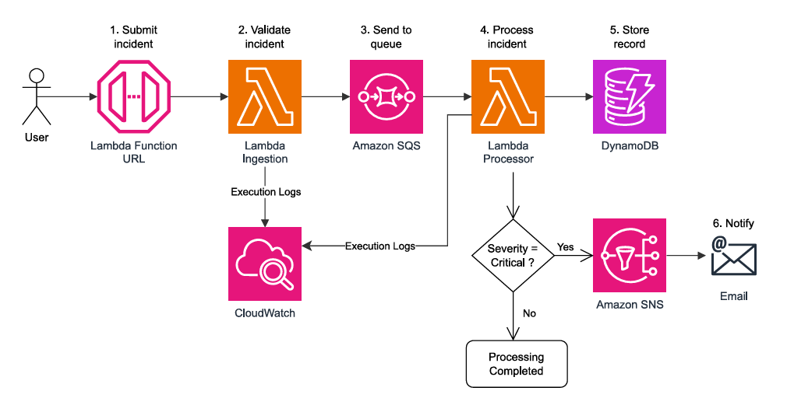

# Serverless Incident Management Platform

A serverless incident management platform built on AWS using Python and Terraform. The project simulates application incidents, validates and processes them asynchronously, stores incident records, and sends email notifications for critical incidents.

## Overview

In distributed applications, incidents such as payment failures, authentication issues, or service degradation need to be detected, processed, and communicated reliably.

This project implements an event-driven architecture that automates part of this workflow using managed AWS services.

The platform allows users to:
- Generate simulated application incidents.
- Submit incidents through an AWS Lambda Function URL.
- Validate incoming incident data.
- Process incidents asynchronously using Amazon SQS.
- Store processed incidents in Amazon DynamoDB.
- Send email notifications through Amazon SNS when an incident is classified as critical.
- Handle failed message processing using an SQS Dead Letter Queue (DLQ).

## Architecture



### Incident processing workflow

1. **Incident generation:** A Python simulator generates incidents containing an ID, service name, severity, description, and UTC timestamp.
2. **Ingestion:** The incident is submitted to the Ingestion Lambda through its Function URL.
3. **Validation:** The ingestion function validates the request and rejects invalid payloads.
4. **Message queuing:** Valid incidents are sent to Amazon SQS.
5. **Asynchronous processing:** Amazon SQS triggers the Processor Lambda.
6. **Persistence:** Valid incidents are stored in DynamoDB.
7. **Critical alerting:** If the incident severity is `critical`, the Processor Lambda publishes a notification to Amazon SNS.
8. **Failure handling:** An SQS Dead Letter Queue is configured to isolate messages that cannot be successfully processed after retries.

## AWS Services

| Service | Purpose |
|---|---|
| AWS Lambda | Runs the ingestion and processing logic without managing servers |
| AWS Lambda Function URL | Provides an HTTPS endpoint for incident submission |
| Amazon SQS | Decouples ingestion from incident processing |
| Amazon SQS DLQ | Isolates messages that repeatedly fail processing |
| Amazon DynamoDB | Stores processed incident records |
| Amazon SNS | Publishes notifications for critical incidents |
| AWS IAM | Controls permissions between AWS services |
| Amazon CloudWatch | Provides Lambda execution logs and monitoring |
| Terraform | Provisions and manages the infrastructure as code |

## Technology Stack

- **Language:** Python 3.13
- **AWS SDK:** Boto3
- **Infrastructure as Code:** Terraform
- **Cloud Platform:** AWS
- **Testing:** Pytest
- **Version Control:** Git and GitHub

## Project Structure

```text
serverless-incident-management/
│
├── simulator/
│   └── incident_generator.py
│
├── src/
│   ├── ingestion/
│   │   └── handler.py
│   │
│   └── processor/
│       └── handler.py
│
├── tests/
│   ├── test_incident_generator.py
│   └── test_ingestion.py
│
├── terraform/
│   ├── main.tf
│   ├── provider.tf
│   ├── variables.tf
│   ├── outputs.tf
│   ├── iam.tf
│   ├── lambda.tf
│   └── .terraform.lock.hcl
│
├── requirements.txt
├── .gitignore
└── README.md
```

## Getting Started

### Prerequisites

Make sure the following tools are installed:

- Python 3.13+
- AWS CLI
- Terraform
- Git
- An AWS account with appropriate permissions

Configure your AWS credentials using the AWS CLI:

```bash
aws configure
```

Verify your AWS identity:

```bash
aws sts get-caller-identity
```

### 1. Clone the repository

```bash
git clone https://github.com/Rimelabed/Serverless-Incident-Management-Platform.git

cd Serverless-Incident-Management-Platform
```

### 2. Set up the Python environment

```bash
python3 -m venv .venv

source .venv/bin/activate

pip install -r requirements.txt
```

### 3. Run the tests

```bash
python -m pytest tests/ -v
```

### 4. Generate simulated incidents

```bash
python simulator/incident_generator.py
```

Generate multiple incidents:

```bash
python simulator/incident_generator.py --count 5
```

The simulator prints JSON incident payloads that can be submitted to the deployed ingestion endpoint.

### 5. Deploy the AWS infrastructure

Navigate to the Terraform directory:

```bash
cd terraform
```

Initialize Terraform:

```bash
terraform init
```

Validate the configuration:

```bash
terraform validate
```

Review the deployment plan:

```bash
terraform plan
```

Deploy the infrastructure:

```bash
terraform apply
```

Review the Terraform outputs to retrieve the deployed resource information, including the ingestion Lambda Function URL.

## Testing and Validation

The project includes unit tests and functional validation of the AWS workflow.

The following scenarios were tested:

| Scenario | Expected behavior | Result |
|---|---|---|
| Valid medium-severity incident | Accepted and stored in DynamoDB | Passed |
| Valid critical incident | Stored and SNS email notification sent | Passed |
| Invalid severity (`urgent`) | Rejected with HTTP 400 | Passed |
| Missing request body | Rejected with HTTP 400 | Passed |
| Invalid JSON payload | Rejected with HTTP 400 | Passed |
| Missing required fields | Rejected with HTTP 400 | Passed |

The critical incident notification workflow was also verified using a confirmed SNS email subscription.

## Design Decisions

### Why Amazon SQS?

SQS decouples incident ingestion from processing. This prevents the ingestion function from having to wait for database operations or notification delivery.

It also provides message buffering and retry capabilities.

### Why DynamoDB?

DynamoDB provides a managed NoSQL database suitable for storing incident records without provisioning or managing database servers.

The processor uses a conditional write to prevent duplicate incident records.

### Why Amazon SNS?

Not every incident requires an immediate email notification. Sending alerts only for critical incidents helps reduce notification noise and alert fatigue.

### Why Terraform?

Terraform makes the infrastructure reproducible, version-controlled, and easier to maintain. AWS resources can be provisioned and destroyed through code rather than manually configured in the console.

## Security and Reliability Considerations

The project uses IAM roles to grant Lambda functions permissions to access the AWS services they require.

Additional reliability mechanisms include:
- Input validation at ingestion and processing stages.
- Asynchronous message processing.
- Conditional DynamoDB writes for basic idempotency.
- SQS retry and Dead Letter Queue configuration.

The Terraform state file, local credentials, environment files, and generated build artifacts are excluded from version control.

## Future Improvements

Potential production-oriented improvements include:

- Add API authentication and request throttling.
- Apply stricter IAM least-privilege policies.
- Implement structured logging and custom CloudWatch metrics.
- Add dashboards and alarms for queue depth, processing failures, and Lambda errors.
- Test retry behavior and DLQ redrive procedures.
- Improve notification reliability using an outbox pattern or a dedicated notification workflow.
- Introduce CI/CD pipelines for automated testing and infrastructure validation.
- Add integration and end-to-end tests.

## Cost Considerations

The architecture relies primarily on managed and serverless AWS services, avoiding continuously running servers.

However, AWS usage may incur charges depending on the account's Free Tier eligibility, service quotas, region, and actual consumption.

Always review the AWS pricing information and monitor your account usage.

## Cleanup

To remove the resources managed by Terraform:

```bash
cd terraform

terraform destroy
```

Review the deletion plan and confirm only when you are ready to remove the infrastructure. This operation also deletes the DynamoDB data managed by the deployed table.

## Author

**Rim El Abed**

Computer Engineering Graduate — Networks and Telecommunications

Interested in Cloud Computing, DevOps, Infrastructure as Code, and Automation.

[GitHub](https://github.com/Rimelabed)